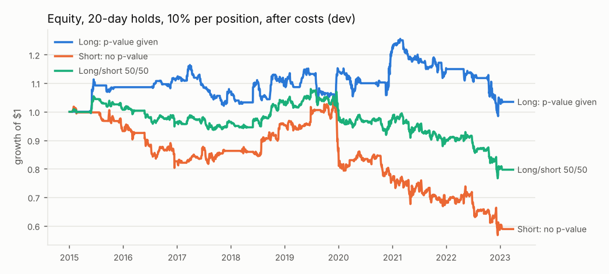
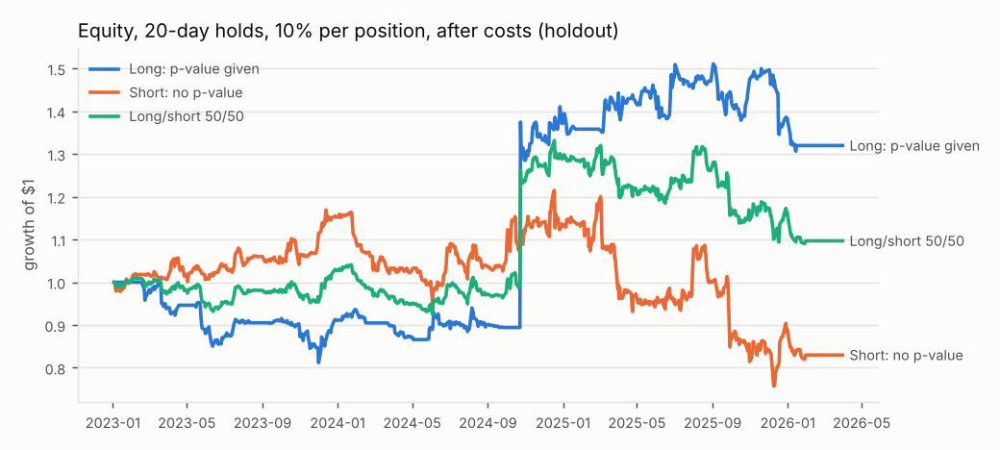
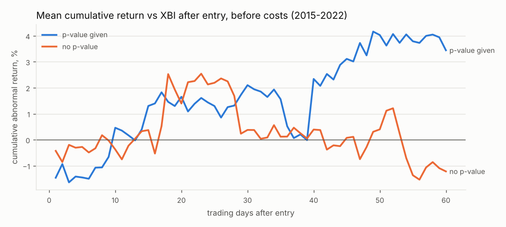
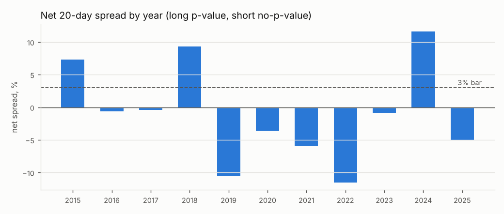

# Biotech p-value backtest: report

**Verdict: NO EDGE**

Hypothesis: biotech press releases that claim positive trial results but give no p-value for the primary endpoint underperform those that give one, over 5-60 trading days.

## Success criteria (pre-registered in config.py)

| Criterion | Result | Pass? |
|---|---|---|
| S1 Holdout net 20d spread ≥ 3% | 1.1% | FAIL |
| S2 Net 20d spread ≥ 3% in most years (2015-2025) | 2 of 11 years pass (10 years have ≥5 events per group) | FAIL |

## Bias checks

| Check | Detail | Pass? |
|---|---|---|
| B1 Holdout run exactly once, after development | first run 2026-10-23T22:18:17.120789+00:00; code hash unchanged since | PASS |
| B2 Every variant logged; none tuned on holdout | 6 variants, 6 logged runs, all on 2015-2022 | PASS |
| B3 95% bootstrap CI of holdout net spread excludes 0 | net 1.1%, CI [-8.3%, 12.1%] | FAIL |
| B4 Placebo: beats ≥95% of 1,000 label shuffles | beats 75.0% of shuffles | FAIL |
| B5 Still ≥3% net after dropping top/bottom 5% | trimmed net -3.9% | FAIL |
| B6 Price data includes delisted stocks | Yahoo Finance only; delisted/acquired names are missing (see Data caveat) | FAIL |

## Data caveat: survivorship bias

No source of daily prices that includes delisted stocks was reachable from this environment (no Tiingo/EODHD/Polygon/CRSP key; Stooq blocked). Prices come from Yahoo Finance, which drops delisted symbols, and EDGAR only maps companies to their *current* tickers. Every company that later went bankrupt, was acquired, or was delisted is missing, so check B6 fails by construction and the verdict can never be "edge" on this data.

## Development 2015-2022

Event funnel:

- filings in period: 4582
- claims success yes: 684
- after 30d company rule: 643
- status no price data: 314
- status traded: 242
- status adv below 500k: 51
- status price below 1: 36

AR = stock return minus XBI return over the same window (entry at the first open after the 8-K acceptance time, exit at the close of trading day N). Net spread = mean AR(p) − mean AR(no-p) − 2 × 0.5% − 20% × N/252 borrow.

| Horizon | Group | N | Mean AR | 95% CI (mean) | Median AR | 95% CI (median) | Hit rate |
|---|---|---|---|---|---|---|---|
| 5d | p-value given | 90 | -1.5% | [-5.2%, 2.6%] | -2.6% | [-4.7%, -0.7%] | 33% |
| 5d | no p-value | 152 | -0.2% | [-2.7%, 2.6%] | -2.5% | [-3.6%, 0.7%] | 45% |
| 20d | p-value given | 90 | 1.7% | [-3.9%, 7.7%] | -2.7% | [-6.4%, -0.2%] | 40% |
| 20d | no p-value | 152 | 1.6% | [-3.1%, 7.6%] | -2.6% | [-6.6%, -0.5%] | 41% |
| 60d | p-value given | 90 | 3.8% | [-4.3%, 13.0%] | -5.4% | [-12.0%, 5.8%] | 44% |
| 60d | no p-value | 152 | -0.8% | [-7.1%, 6.2%] | -5.7% | [-10.3%, -0.9%] | 40% |

| Horizon | Gross spread (mean p − mean no-p) | Net spread after costs | 95% CI (net) | Median spread | 95% CI (median) | Short no-p leg, net | Long p leg, net |
|---|---|---|---|---|---|---|---|
| 5d | -1.3% | **-2.7%** | [-7.5%, 2.2%] | -0.1% | [-4.1%, 2.1%] | -0.7% | -2.0% |
| 20d | 0.1% | **-2.5%** | [-10.6%, 5.2%] | -0.1% | [-4.0%, 4.6%] | -3.7% | 1.2% |
| 60d | 4.6% | **-1.2%** | [-11.9%, 9.8%] | 0.3% | [-9.1%, 12.2%] | -4.5% | 3.3% |

Placebo and trimming:

| Horizon | Real gross spread | Shuffles beaten | 95th pct of shuffles | Trimmed net spread (N p / N no-p) |
|---|---|---|---|---|
| 5d | -1.3% | 28.7% | 4.4% | -2.8% (79 / 137) |
| 20d | 0.1% | 50.2% | 7.6% | -3.0% (79 / 137) |
| 60d | 4.6% | 81.6% | 8.8% | -7.0% (81 / 135) |

Calendar-time portfolio (daily XBI hedge, costs and borrow included, rf = 0). Two sizings: equal weight across whatever positions are open (often 1-3 names, so very concentrated), and 10% of capital per position with idle cash at 0. The 10% sizing was added after seeing the development-period drawdowns; it is reporting only and does not enter the verdict.

| Hold | Sleeve | CAGR | Ann. vol | Sharpe | Sortino | Max DD | Calmar | Total return | Days invested | Avg positions |
|---|---|---|---|---|---|---|---|---|---|---|
| 5d | Long p-value | -24.4% | 48.2% | -0.35 | -0.55 | -96.9% | -0.25 | -90.0% | 20% | 1.1 |
| 5d | Short no-p-value | -21.8% | 56.4% | -0.12 | -0.14 | -97.6% | -0.22 | -86.8% | 30% | 1.2 |
| 5d | Long/short | -16.8% | 36.3% | -0.32 | -0.43 | -93.8% | -0.18 | -78.1% | 42% | 1.4 |
| 5d | Long p-value (10%/pos) | -2.8% | 5.2% | -0.53 | -0.77 | -32.0% | -0.09 | -21.0% | 20% | 1.1 |
| 5d | Short no-p (10%/pos) | -1.0% | 6.7% | -0.12 | -0.15 | -25.2% | -0.04 | -8.2% | 30% | 1.2 |
| 5d | Long/short (10%/pos) | -1.8% | 4.1% | -0.43 | -0.56 | -25.7% | -0.07 | -14.2% | 42% | 1.4 |
| 20d | Long p-value | -8.7% | 51.3% | 0.07 | 0.11 | -85.3% | -0.10 | -52.8% | 57% | 1.5 |
| 20d | Short no-p-value | -48.4% | 68.2% | -0.57 | -0.70 | -99.6% | -0.49 | -99.6% | 74% | 2.0 |
| 20d | Long/short | -23.6% | 42.4% | -0.42 | -0.55 | -91.5% | -0.26 | -89.2% | 84% | 2.8 |
| 20d | Long p-value (10%/pos) | 0.4% | 8.2% | 0.09 | 0.15 | -21.6% | 0.02 | 3.5% | 57% | 1.5 |
| 20d | Short no-p (10%/pos) | -6.2% | 11.3% | -0.51 | -0.65 | -45.1% | -0.14 | -41.1% | 74% | 2.0 |
| 20d | Long/short (10%/pos) | -2.7% | 6.9% | -0.37 | -0.50 | -29.0% | -0.09 | -20.3% | 84% | 2.8 |
| 60d | Long p-value | 13.3% | 43.9% | 0.49 | 0.83 | -75.2% | 0.18 | 180.4% | 84% | 3.1 |
| 60d | Short no-p-value | -24.3% | 42.3% | -0.45 | -0.63 | -91.8% | -0.26 | -89.9% | 94% | 4.7 |
| 60d | Long/short | -3.1% | 30.5% | 0.04 | 0.07 | -77.2% | -0.04 | -23.1% | 98% | 7.2 |
| 60d | Long p-value (10%/pos) | 2.8% | 12.3% | 0.28 | 0.45 | -23.4% | 0.12 | 25.2% | 84% | 3.1 |
| 60d | Short no-p (10%/pos) | -9.8% | 18.4% | -0.47 | -0.63 | -68.9% | -0.14 | -57.1% | 94% | 4.7 |
| 60d | Long/short (10%/pos) | -3.1% | 10.7% | -0.24 | -0.33 | -44.5% | -0.07 | -22.6% | 98% | 7.2 |

## Holdout 2023-2025 (single run)

Event funnel:

- filings in period: 2160
- claims success yes: 346
- after 30d company rule: 323
- status traded: 196
- status no price data: 48
- status adv below 500k: 40
- status price below 1: 39

AR = stock return minus XBI return over the same window (entry at the first open after the 8-K acceptance time, exit at the close of trading day N). Net spread = mean AR(p) − mean AR(no-p) − 2 × 0.5% − 20% × N/252 borrow.

| Horizon | Group | N | Mean AR | 95% CI (mean) | Median AR | 95% CI (median) | Hit rate |
|---|---|---|---|---|---|---|---|
| 5d | p-value given | 74 | 2.0% | [-3.7%, 8.9%] | -1.2% | [-3.8%, 2.2%] | 45% |
| 5d | no p-value | 122 | -2.0% | [-5.7%, 1.8%] | -0.9% | [-3.8%, 1.4%] | 45% |
| 20d | p-value given | 74 | 2.1% | [-5.4%, 11.9%] | -4.0% | [-7.3%, 2.9%] | 42% |
| 20d | no p-value | 122 | -1.6% | [-6.7%, 3.7%] | -4.2% | [-6.5%, 1.0%] | 43% |
| 60d | p-value given | 74 | 8.9% | [-5.3%, 28.5%] | -1.3% | [-12.9%, 6.2%] | 49% |
| 60d | no p-value | 122 | -3.3% | [-10.5%, 4.2%] | -7.9% | [-12.3%, -2.1%] | 39% |

| Horizon | Gross spread (mean p − mean no-p) | Net spread after costs | 95% CI (net) | Median spread | 95% CI (median) | Short no-p leg, net | Long p leg, net |
|---|---|---|---|---|---|---|---|
| 5d | 4.0% | **2.6%** | [-4.4%, 10.6%] | -0.2% | [-3.9%, 3.8%] | 1.1% | 1.5% |
| 20d | 3.7% | **1.1%** | [-8.3%, 12.1%] | 0.2% | [-6.8%, 7.2%] | -0.5% | 1.6% |
| 60d | 12.2% | **6.4%** | [-10.0%, 27.6%] | 6.6% | [-5.5%, 16.6%] | -2.0% | 8.4% |

Placebo and trimming:

| Horizon | Real gross spread | Shuffles beaten | 95th pct of shuffles | Trimmed net spread (N p / N no-p) |
|---|---|---|---|---|
| 5d | 4.0% | 86.2% | 5.8% | -1.7% (68 / 108) |
| 20d | 3.7% | 75.0% | 8.6% | -3.9% (68 / 108) |
| 60d | 12.2% | 90.9% | 14.9% | -6.4% (69 / 107) |

Calendar-time portfolio (daily XBI hedge, costs and borrow included, rf = 0). Two sizings: equal weight across whatever positions are open (often 1-3 names, so very concentrated), and 10% of capital per position with idle cash at 0. The 10% sizing was added after seeing the development-period drawdowns; it is reporting only and does not enter the verdict.

| Hold | Sleeve | CAGR | Ann. vol | Sharpe | Sortino | Max DD | Calmar | Total return | Days invested | Avg positions |
|---|---|---|---|---|---|---|---|---|---|---|
| 5d | Long p-value | -0.4% | 309.5% | 0.46 | 2.43 | -80.9% | -0.01 | -1.3% | 34% | 1.4 |
| 5d | Short no-p-value | -35.0% | 90.6% | 0.06 | 0.08 | -94.0% | -0.37 | -75.1% | 52% | 1.5 |
| 5d | Long/short | 14.6% | 160.2% | 0.46 | 1.75 | -59.0% | 0.25 | 55.2% | 63% | 1.9 |
| 5d | Long p-value (10%/pos) | 9.4% | 31.6% | 0.40 | 1.64 | -15.3% | 0.61 | 33.5% | 34% | 1.4 |
| 5d | Short no-p (10%/pos) | 3.6% | 15.0% | 0.31 | 0.42 | -23.9% | 0.15 | 12.0% | 52% | 1.5 |
| 5d | Long/short (10%/pos) | 7.7% | 17.3% | 0.50 | 1.35 | -13.0% | 0.59 | 26.9% | 63% | 1.9 |
| 20d | Long p-value | 36.1% | 307.6% | 0.54 | 3.21 | -76.0% | 0.48 | 170.3% | 73% | 2.5 |
| 20d | Short no-p-value | -41.0% | 56.9% | -0.64 | -0.82 | -91.6% | -0.45 | -81.8% | 92% | 3.3 |
| 20d | Long/short | 13.5% | 155.7% | 0.42 | 2.01 | -52.2% | 0.26 | 50.5% | 93% | 5.2 |
| 20d | Long p-value (10%/pos) | 9.0% | 32.7% | 0.39 | 1.33 | -18.8% | 0.48 | 32.0% | 73% | 2.5 |
| 20d | Short no-p (10%/pos) | -5.6% | 19.7% | -0.19 | -0.25 | -37.7% | -0.15 | -17.0% | 92% | 3.3 |
| 20d | Long/short (10%/pos) | 2.9% | 18.9% | 0.24 | 0.51 | -18.1% | 0.16 | 9.7% | 93% | 5.2 |
| 60d | Long p-value | 27.9% | 105.3% | 0.52 | 1.94 | -57.7% | 0.48 | 121.2% | 95% | 5.8 |
| 60d | Short no-p-value | -23.3% | 39.2% | -0.45 | -0.53 | -72.4% | -0.32 | -57.4% | 100% | 9.0 |
| 60d | Long/short | 7.5% | 56.1% | 0.34 | 0.87 | -33.9% | 0.22 | 26.4% | 100% | 14.5 |
| 60d | Long p-value (10%/pos) | 18.7% | 35.0% | 0.63 | 1.73 | -27.5% | 0.68 | 74.0% | 95% | 5.8 |
| 60d | Short no-p (10%/pos) | -13.6% | 30.6% | -0.31 | -0.37 | -59.5% | -0.23 | -37.7% | 100% | 9.0 |
| 60d | Long/short (10%/pos) | 3.9% | 22.9% | 0.28 | 0.46 | -22.4% | 0.17 | 13.2% | 100% | 14.5 |

## Results by year (20-day hold)

| Year | N p-value | N no-p | Mean AR p-value | Mean AR no-p | Net spread | ≥5 per group | ≥3% |
|---|---|---|---|---|---|---|---|
| 2015 | 4 | 5 | 24.1% | 14.2% | 7.3% | no | fail |
| 2016 | 5 | 14 | 6.8% | 4.9% | -0.7% | yes | fail |
| 2017 | 13 | 17 | -2.7% | -4.9% | -0.4% | yes | fail |
| 2018 | 14 | 15 | 4.1% | -7.8% | 9.3% | yes | PASS |
| 2019 | 14 | 18 | 6.0% | 13.9% | -10.5% | yes | fail |
| 2020 | 16 | 17 | 4.1% | 5.0% | -3.6% | yes | fail |
| 2021 | 13 | 39 | -5.0% | -1.6% | -6.0% | yes | fail |
| 2022 | 11 | 27 | -7.7% | 1.2% | -11.5% | yes | fail |
| 2023 | 18 | 29 | -5.3% | -7.1% | -0.8% | yes | fail |
| 2024 | 23 | 37 | 11.4% | -2.8% | 11.6% | yes | PASS |
| 2025 | 33 | 56 | -0.3% | 2.1% | -5.0% | yes | fail |

## Stocks that stopped trading before exit (last traded price used)

No traded event lost its price series before exit.

## Every variant tried (development period only)

| Run (UTC) | Variant | Description | N p / no-p (20d) | Net spread 20d | 95% CI | Shuffles beaten |
|---|---|---|---|---|---|---|
| 2026-10-23T22:16:40 | V0_primary | pre-registered spec: claims_success=yes, p-value for primary endpoint yes vs no, Item 2.02 filings excluded | 90 / 152 | -2.5% | [-10.6%, 5.2%] | 50.2% |
| 2026-10-23T22:16:40 | V1_keep_item_2.02 | spec-literal universe: keep 8-Ks with Item 2.02 (earnings releases) | 92 / 164 | -2.4% | [-10.3%, 5.2%] | 53.1% |
| 2026-10-23T22:16:40 | V2_pvalue_any | group on ANY p-value in the release instead of one tied to the primary endpoint | 126 / 116 | 2.0% | [-5.2%, 10.5%] | 85.4% |
| 2026-10-23T22:16:40 | V3_phase3_only | only Phase 3 or 2/3 trials (controls for phase mix) | 59 / 47 | 0.0% | [-6.8%, 6.9%] | 75.5% |
| 2026-10-23T22:16:40 | V4_phase2_only | only Phase 2 or 1/2 trials (controls for phase mix) | 24 / 77 | 1.5% | [-14.8%, 18.6%] | 70.6% |
| 2026-10-23T22:16:40 | V5_phase1_only | only Phase 1 trials | 4 / 18 | -4.9% | [-26.2%, 24.7%] | 43.7% |

## Descriptive numbers (development period)

```json
{
 "failed_trials": {
  "5": {
   "n": 65,
   "mean_ar": -0.022628965589153137,
   "median_ar": -0.008328248767365931
  },
  "20": {
   "n": 65,
   "mean_ar": -3.730662172645684e-05,
   "median_ar": -0.0008855613809497509
  },
  "60": {
   "n": 65,
   "mean_ar": 0.0654953108890026,
   "median_ar": -0.04741151752805162
  }
 },
 "pre_entry_move": {
  "p_value": {
   "n": 90,
   "mean": 0.17308835813725634,
   "median": 0.04619042672290585
  },
  "no_p_value": {
   "n": 152,
   "mean": 0.049552467893611604,
   "median": 0.008707371777125217
  }
 },
 "phase_mix": {
  "no": {
   "1": 18,
   "1/2": 12,
   "2": 65,
   "2/3": 3,
   "3": 44,
   "unknown": 10
  },
  "yes": {
   "1": 4,
   "1/2": 0,
   "2": 24,
   "2/3": 3,
   "3": 56,
   "unknown": 3
  }
 },
 "status_by_group": {
  "no": {
   "adv_below_500k": 39,
   "no_price_data": 199,
   "price_below_1": 30,
   "traded": 152
  },
  "yes": {
   "adv_below_500k": 12,
   "no_price_data": 115,
   "price_below_1": 6,
   "traded": 90
  }
 },
 "pvalue_rate_by_year": {
  "2015": 0.37254901960784315,
  "2016": 0.352112676056338,
  "2017": 0.43209876543209874,
  "2018": 0.40476190476190477,
  "2019": 0.3627450980392157,
  "2020": 0.43820224719101125,
  "2021": 0.2631578947368421,
  "2022": 0.22522522522522523,
  "2023": 0.35353535353535354,
  "2024": 0.3805309734513274,
  "2025": 0.3208955223880597
 },
 "label_counts_all_years": {
  "claims_success": 1030,
  "by_pvalue": {
   "no": 670,
   "yes": 360
  }
 }
}
```

## Classifier

Rule-based, blind (sees only redacted text), frozen with SHA-256 `4aacf43c0ff06914…`; freeze history: 3 entries, returns existed at any freeze: False. Spot checks: `spot_check_random30.md`, `spot_check_tradeable30.md`.

## Charts





